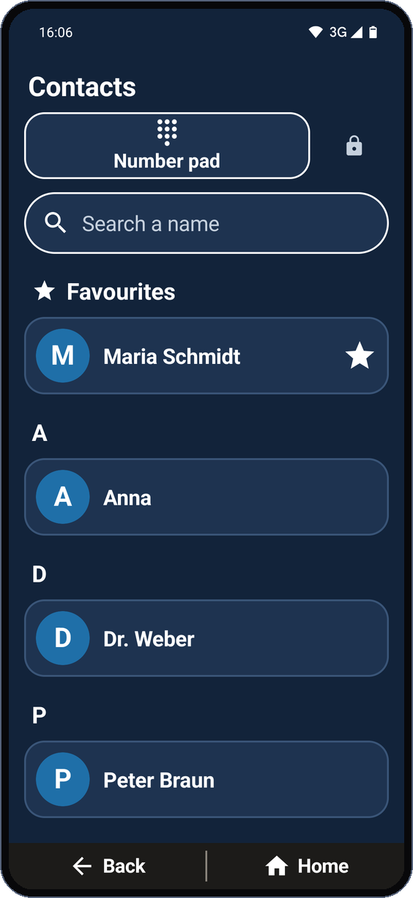
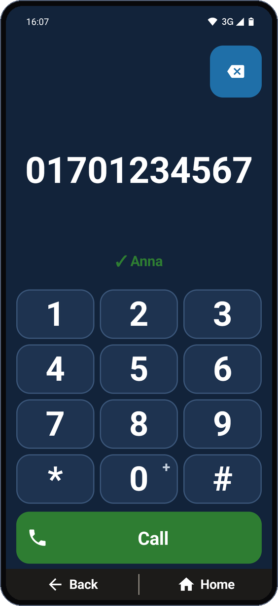
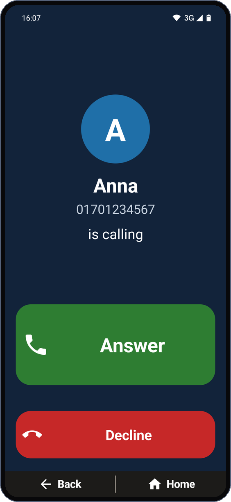

# SeniorPhone

A very simple phone for Android, made for seniors.

Big names, favourites at the top, one big green Call button. When someone
calls, the whole screen shows who it is, with a huge **Answer** button.

English and German. The app follows the phone's language.

It puts two icons on the home screen: **Phone** (green handset) opens the
number pad, **Contacts** (blue address book) opens the contact list.

[Deutsch weiter unten](#seniorphone-deutsch)

## What you see

  
  
  

- **Contacts**: your favourites first, then everyone from A to Z, in large
  letters. Search by name.
- Tap a person: their picture, name and a big green **Call**. The phone asks
  "Call Maria Schmidt?" once more, so nobody is called by accident.
- **Number pad** for numbers that are not in your contacts. While you type, it says whose number it is ("✓ Maria Schmidt"), or offers the one contact whose number starts like that; a tap fills in the rest.
- **When someone calls**: their name (or number), a huge green **Answer** and,
  below it, a red **Decline**. It works on the lock screen too, also right
  after the phone was switched on (then with the number instead of the name).
- **During a call**: who you are talking to, how long, a big red **Hang up**,
  **Speaker**, **Louder**, **Microphone** (on or off, said in words) and
  **Keypad**, a big pad for the menus of a hotline ("press 1 for …").
  Left the call screen? Contacts, the number pad and a person's page show a
  green **Back to the call**, and nobody else is called by mistake while the
  call is on.
- **Missed call**: a notification with the caller's name and the time. Tap
  it for their page; **Call back** asks "Call Maria Schmidt?" first.

## Install

1. Download the latest `SeniorPhone-*.apk` from the
   [Releases](https://github.com/SeniorPhoneKit/SeniorPhone/releases) page on
   the phone.
2. Open it. Android asks whether to allow installing from this source; allow it
   once.
3. Open **Contacts**. It asks to become the phone app; say yes. Then allow
   contacts and notifications.

Needs Android 8.0 or newer and a phone with a SIM card.

## Setting it up (for the helper)

- Tap the star next to a person to make them a favourite; they move to the top.
- **New contact** adds a person; on their page, **Edit** and **Delete**.
- **Settings → Colours**: Light, Dark, High contrast or Colourful.
- **Lock**: locking the home screen (SeniorLauncher: Settings → Lock) locks
  the phone too. Afterwards the favourites stay as they are, and nobody can be
  added, changed or deleted by accident. Calling still works. To unlock, hold
  the padlock (here or on the home screen) and enter the home screen's PIN.
  Without SeniorLauncher: Settings → Lock here with a PIN of its own, and hold
  the padlock to unlock. Forgotten PIN: the reset PIN **506614** always opens
  the lock.

## Widgets on the home screen

- **Call** (one person): one tile with a person's picture and first name.
  When you add it, choose who it calls. A tap asks "Call Maria Schmidt?".
- **Favourites**: your favourites, one big row each. A tap asks "Call …?".
  It follows the stars in Contacts by itself. It shows as many whole rows as
  fit and never scrolls; when not all fit, the last line says "+3 more – tap
  to see all" and opens Contacts. Make it taller to see more.

With SeniorLauncher: home screen → **Widgets** → search "Phone" → tap the
widget. The Favourites widget can be made taller there (1 row, 2 rows, Full
page). On other home screens: hold the home screen → Widgets → Phone. To
change the person: remove the widget and add it again, or (where the home
screen offers it) reconfigure it.

## Automation (Trigly, Tasker, …)

Other apps can control SeniorPhone with intents to package
`app.phueber.seniorphone`. Every action starts with
`app.phueber.seniorphone.action.`; all extras are text. Placing a call always
stops at the "Call Maria Schmidt?" question: no app can make SeniorPhone call
by itself. A `number` with `*` or `#` (a network code such as call
forwarding) is ignored; such codes can only be typed on the number pad.

| Send as | Action | Extras | What it does |
|---|---|---|---|
| Activity | `CALL` | `number` or `name` | Opens the person's page (or the number pad) and asks "Call …?". |
| Activity | `OPEN_CONTACT` | `name` or `number` | Opens the person's page; if no one or several match, the list searched for the name. |
| Activity | `OPEN_DIALPAD` | `number` (optional) | Opens the number pad, with the number typed in. |
| Activity | `OPEN_CONTACTS` | `name` (optional) | Opens the contact list, searched for the name. |
| Broadcast | `ANSWER` | – | Answers the ringing call. * |
| Broadcast | `HANG_UP` | – | Declines the ringing call, or hangs up. * |
| Broadcast | `SPEAKER` | `state`: `on`, `off`, `toggle` (default) | Speaker on or off. * |
| Broadcast | `LOUDER` | – | Call one step louder. * |
| Broadcast | `LOCK` | `pin` (4–8 digits) | Locks with this PIN. Only without SeniorLauncher (lock the home screen instead) and only while unlocked. |
| Broadcast | `UNLOCK` | `pin` | Unlocks with the PIN or the reset PIN; also the home screen's lock. |
| Broadcast | `SET_THEME` | `theme`: `light`, `dark`, `high_contrast`, `colourful` | Changes the colours. |

\* Only from apps that hold the permission to answer phone calls
(`ANSWER_PHONE_CALLS`). Without a call they do nothing. A name matches when
it is the contact's name (case and accents do not matter) or part of exactly
one contact's name.

Example (Trigly, action "Fire an intent"): send mode **Broadcast**, package
`app.phueber.seniorphone`, action `app.phueber.seniorphone.action.SET_THEME`,
extra `theme` = `dark` — e.g. at sunset.

## SeniorPhone (Deutsch)

Ein sehr einfaches Telefon für Android, gemacht für Senioren.

Große Namen, Favoriten oben, ein großer grüner Knopf zum Anrufen. Wenn jemand
anruft, zeigt der ganze Bildschirm, wer es ist, mit einem riesigen Knopf
**Annehmen**.

Es legt zwei Symbole auf die Startseite: **Telefon** (grüner Hörer) öffnet das
Tastenfeld, **Kontakte** (blaues Adressbuch) öffnet die Kontaktliste.

### Was Sie sehen

- **Kontakte**: zuerst Ihre Favoriten, dann alle von A bis Z, in großer Schrift.
  Suche nach Namen.
- Tippen Sie eine Person an: Bild, Name und ein großes grünes **Anrufen**. Das
  Telefon fragt noch einmal „Maria Schmidt anrufen?“, damit niemand aus
  Versehen angerufen wird.
- **Tastenfeld** für Nummern, die nicht in Ihren Kontakten stehen. Beim Tippen steht darunter, wem die Nummer gehört („✓ Maria Schmidt“), oder es wird der eine Kontakt angeboten, dessen Nummer so beginnt; ein Tippen ergänzt den Rest.
- **Wenn jemand anruft**: der Name (oder die Nummer), ein riesiges grünes
  **Annehmen** und darunter ein rotes **Ablehnen**. Auch auf dem Sperrbildschirm,
  auch gleich nach dem Einschalten (dann mit der Nummer statt des Namens).
- **Während eines Gesprächs**: mit wem Sie sprechen, wie lange, ein großes rotes
  **Auflegen**, **Lautsprecher**, **Lauter**, **Mikrofon** (an oder aus, in
  Worten) und **Tastatur**, ein großes Tastenfeld für Sprachmenüs einer
  Hotline („drücken Sie die 1 für …“). Den Anrufbildschirm verlassen?
  Kontakte, Tastenfeld und die Seite einer Person zeigen ein grünes
  **Zurück zum Anruf**, und während des Gesprächs wird niemand sonst
  versehentlich angerufen.
- **Verpasster Anruf**: eine Benachrichtigung mit Name und Uhrzeit. Antippen
  öffnet die Seite der Person; **Zurückrufen** fragt erst „Maria Schmidt
  anrufen?“.

### Installieren

1. Laden Sie auf dem Telefon die neueste `SeniorPhone-*.apk` von der Seite
   [Releases](https://github.com/SeniorPhoneKit/SeniorPhone/releases).
2. Öffnen Sie sie. Android fragt, ob aus dieser Quelle installiert werden darf;
   erlauben Sie es einmal.
3. Öffnen Sie **Kontakte**. Es fragt, ob es die Telefon-App werden soll; sagen Sie
   Ja. Erlauben Sie dann Kontakte und Benachrichtigungen.

Benötigt Android 8.0 oder neuer und ein Telefon mit SIM-Karte.

### Einrichten (für Helfer)

- Tippen Sie auf den Stern neben einer Person, um sie zum Favoriten zu machen;
  sie rückt nach oben.
- **Neuer Kontakt** legt eine Person an; auf ihrer Seite **Ändern** und
  **Löschen**.
- **Einstellungen → Farben**: Hell, Dunkel, Hoher Kontrast oder Bunt.
- **Sperren**: Wird die Startseite gesperrt (SeniorLauncher: Einstellungen →
  Sperren), ist auch das Telefon gesperrt. Danach bleiben die Favoriten, wie sie
  sind, und niemand kann aus Versehen hinzugefügt, geändert oder gelöscht
  werden. Anrufen geht weiterhin. Zum Entsperren das Schloss gedrückt halten
  (hier oder auf der Startseite) und die PIN der Startseite eingeben. Ohne
  SeniorLauncher: hier Einstellungen → Sperren mit eigener PIN, zum Entsperren
  das Schloss gedrückt halten. PIN vergessen: die Reset-PIN **506614** öffnet
  die Sperre immer.

### Widgets auf der Startseite

- **Anrufen** (eine Person): eine Kachel mit Bild und Vorname einer Person.
  Beim Hinzufügen wählen Sie, wen sie anruft. Ein Tippen fragt
  „Maria Schmidt anrufen?“.
- **Favoriten**: Ihre Favoriten, jede Person eine große Zeile. Ein Tippen fragt
  „… anrufen?“. Folgt von selbst den Sternen in den Kontakten. Es zeigt so
  viele ganze Zeilen, wie hineinpassen, und blättert nie; passen nicht alle,
  sagt die letzte Zeile „+3 weitere – tippen für alle“ und öffnet die
  Kontakte. Höher gemacht zeigt es mehr.

Mit SeniorLauncher: Startseite → **Widgets** → „Telefon“ suchen → Widget
antippen. Das Favoriten-Widget lässt sich dort höher machen (1 Zeile,
2 Zeilen, Ganze Seite). Auf anderen Startseiten: Startseite gedrückt halten →
Widgets → Telefon. Person ändern: Widget entfernen und neu hinzufügen, oder
(wo die Startseite es anbietet) neu einrichten.

### Automatisierung (Trigly, Tasker, …)

Andere Apps können SeniorPhone mit Intents an das Paket
`app.phueber.seniorphone` steuern. Jede Aktion beginnt mit
`app.phueber.seniorphone.action.`; alle Extras sind Text. Ein Anruf endet
immer bei der Frage „Maria Schmidt anrufen?“: Keine App kann SeniorPhone von
selbst anrufen lassen. Eine `number` mit `*` oder `#` (ein Netzcode wie eine
Rufumleitung) wird ignoriert; solche Codes lassen sich nur auf dem Tastenfeld
eintippen.

| Senden als | Aktion | Extras | Was passiert |
|---|---|---|---|
| Activity | `CALL` | `number` oder `name` | Öffnet die Seite der Person (oder das Tastenfeld) und fragt „… anrufen?“. |
| Activity | `OPEN_CONTACT` | `name` oder `number` | Öffnet die Seite der Person; passt niemand oder mehrere, die Liste mit dem Namen gesucht. |
| Activity | `OPEN_DIALPAD` | `number` (optional) | Öffnet das Tastenfeld, mit der Nummer schon eingetippt. |
| Activity | `OPEN_CONTACTS` | `name` (optional) | Öffnet die Kontaktliste, nach dem Namen gesucht. |
| Broadcast | `ANSWER` | – | Nimmt den klingelnden Anruf an. * |
| Broadcast | `HANG_UP` | – | Lehnt den klingelnden Anruf ab oder legt auf. * |
| Broadcast | `SPEAKER` | `state`: `on`, `off`, `toggle` (Standard) | Lautsprecher an oder aus. * |
| Broadcast | `LOUDER` | – | Gespräch eine Stufe lauter. * |
| Broadcast | `LOCK` | `pin` (4–8 Ziffern) | Sperrt mit dieser PIN. Nur ohne SeniorLauncher (dann die Startseite sperren) und nur, wenn nicht schon gesperrt. |
| Broadcast | `UNLOCK` | `pin` | Entsperrt mit der PIN oder der Reset-PIN; auch die Sperre der Startseite. |
| Broadcast | `SET_THEME` | `theme`: `light`, `dark`, `high_contrast`, `colourful` | Ändert die Farben. |

\* Nur von Apps, die Anrufe annehmen dürfen (`ANSWER_PHONE_CALLS`). Ohne
Anruf passiert nichts. Ein Name passt, wenn er der Name des Kontakts ist
(Groß-/Kleinschreibung und Akzente egal) oder Teil des Namens von genau einem
Kontakt.

Beispiel (Trigly, Aktion „Intent senden“): Sendeart **Broadcast**, Paket
`app.phueber.seniorphone`, Aktion `app.phueber.seniorphone.action.SET_THEME`,
Extra `theme` = `dark` – z. B. bei Sonnenuntergang.

## Contributing

See [CONTRIBUTING.md](CONTRIBUTING.md) and [ARCHITECTURE.md](ARCHITECTURE.md).
Licensed under the [Apache License 2.0](LICENSE).
